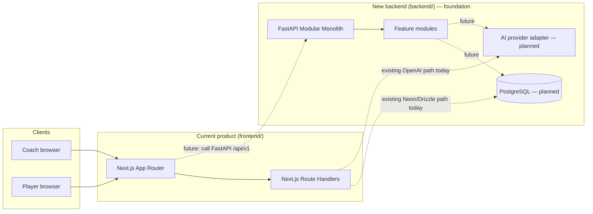

# Diagram 1 — High-Level System Architecture

Notes:
- Solid lines = current primary path for the live product UI.
- Dashed lines = planned or dual-running paths during migration.
- This foundation does **not** disconnect the existing frontend data path.
